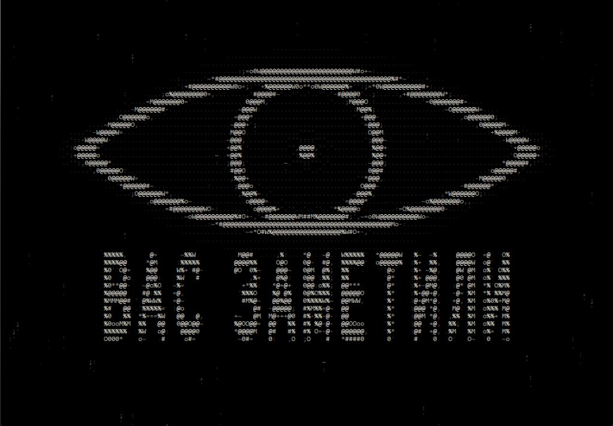

<div align="center">

# ВАС ЗАМЕТИЛИ

**Процедурная генеративная ASCII-анимация на Python**


<br>



</div>

---

## О проекте

Вся графика, анимация и кириллическая надпись **«ВАС ЗАМЕТИЛИ»** вычисляются математически в реальном времени без внешних изображений, спрайтов и шрифтовых файлов — только `NumPy` и встроенный `Tkinter`.

### Особенности
- **Процедурная геометрия (SDF)** — плавные знаковые поля расстояний для контура, радужки, зрачка и сглаженного свечения (`bloom`).
- **Векторная кириллица в ASCII** — каждая буква надписи **«ВАС ЗАМЕТИЛИ»** строится аналитически из сегментов и эллиптических дуг.
- **Сценарная таймлайн-анимация** — выход из темноты, раскрытие, быстрый осмотр по сторонам, фиксация в центр с импульсной волной и живое дыхание сцены с редкими морганиями.
- **Оптимизированный рендер** — упаковка ячеек в `int32`-буфер и перерисовка через `np.flatnonzero` только изменившихся символов (`40 FPS`).

---

## Быстрый запуск

```bash
pip install -r requirements.txt
python main.py
```

Сделать текстовый снимок кадра в консоль на таймкоде `T` (в секундах):

```bash
python main.py --snapshot 8.5
```

---

## Управление

| Клавиша | Действие |
| :---: | :--- |
| `R` | Перезапустить анимацию с начала |
| `Space` | Пауза / продолжить |
| `B` | Моргнуть и пустить импульс обнаружения |
| `M` | Сменить тему (`Skyrim Silver`, `Detected Crimson`, `Nordic Frost`, `Dwemer Gold`) |
| `H` | Скрыть / показать нижнюю строку подсказок |
| `Esc` | Выход |

---

## Структура

```text
.
├── main.py              # Движок сцены и Tkinter-рендерер
├── requirements.txt     # Зависимости (numpy)
├── assets/
│   └── preview.jpg      # Превью для README
└── README.md
```
